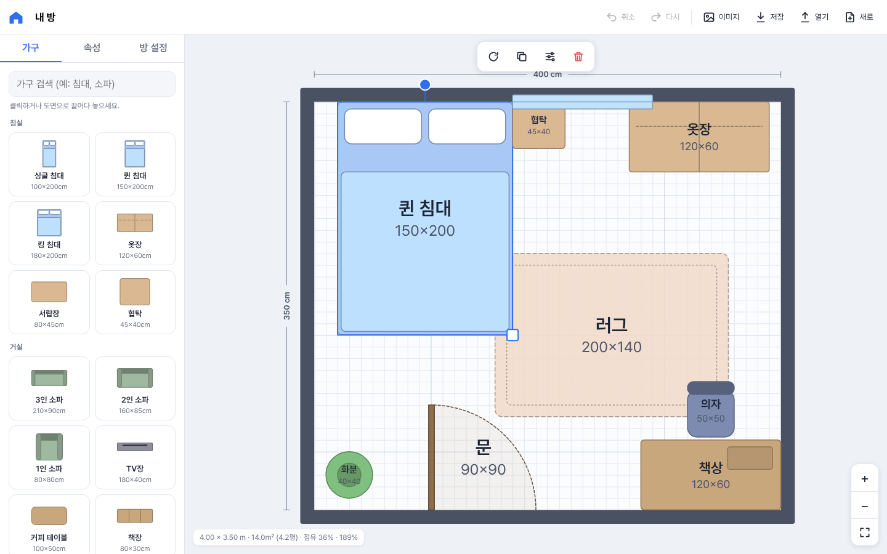

# 방 배치 플래너

방 크기를 입력하고 가구를 끌어다 배치해 볼 수 있는 인테리어 배치 웹 앱입니다. 휴대폰에서는 홈 화면에 설치해 앱처럼 쓸 수 있습니다(PWA).

- 방 크기 설정, 22가지 가구 배치(이동, 회전, 크기 변경, 그리드·벽 스냅)
- 겹침 및 방 밖 배치 경고, 면적(㎡/평)과 가구 점유율 표시
- 실행 취소/다시 실행, 자동 저장, JSON 저장/불러오기, PNG 내보내기
